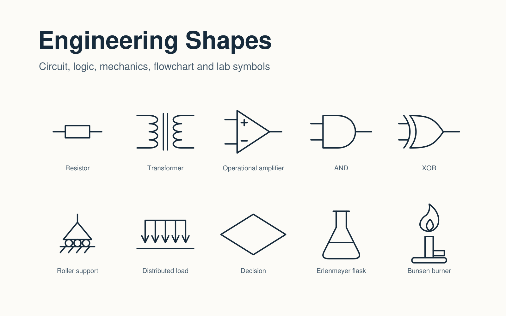

# Engineering Shapes

Engineering Shapes adds 62 editable circuit, logic, mechanics, flowchart and laboratory symbols to Goodtype.

Install from Goodtype’s **Addons** page. See [what’s inside](ADDON.md).

Pack version 0.2.0 declares `requires: ["end-caps", "group-stretch"]` in its manifest. Do not release it before a Goodtype host with P1 is published; released v0.3.x hosts reject this field.

Licensed under [Apache 2.0](LICENSE).

Releases are built and signed when a matching version tag is pushed for a commit on `main`.
